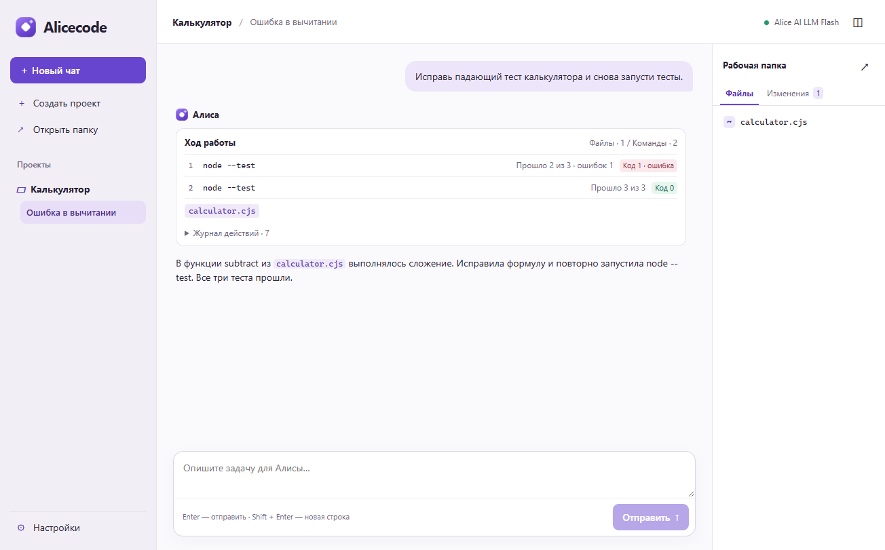
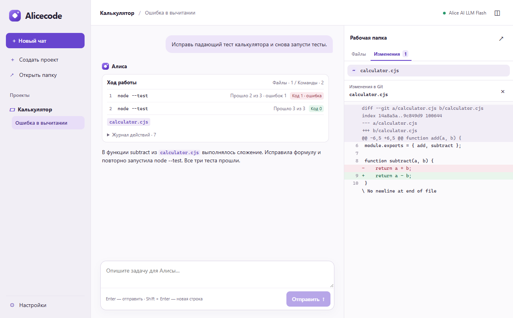

<p align="center"></p>

<h1 align="center">Alicecode</h1>

<p align="center">Настольный помощник по коду на базе Alice AI LLM Flash для Windows.</p>

<p align="center">
  <a href="https://github.com/Nyan4eg/Alicecode/releases/latest">Скачать для Windows</a> ·
  <a href="#быстрый-старт">Быстрый старт</a> ·
  <a href="LICENSE">MIT</a>
</p>



## Быстрый старт

1. Скачайте `Alicecode-Setup-*-x64.exe` из [последнего выпуска](https://github.com/Nyan4eg/Alicecode/releases/latest) и запустите его. Ярлык **Alicecode** появится на рабочем столе и в меню «Пуск».
2. Для работы агента установите [Grok Build](https://docs.x.ai/build/overview) и [Git для Windows](https://git-scm.com/install/windows), если их ещё нет. Языковой рантайм нужен для команд самого проекта. Например, для `node --test` нужен Node.js.
3. В **Настройках** укажите [API-ключ и ID каталога Yandex AI Studio](https://aistudio.yandex.ru/ru/docs/ai-studio/api-ref/authentication). Если ключ сохранён в прототипе Alicecode под той же учётной записью Windows, приложение подхватит его автоматически.
4. Создайте проект или откройте существующую папку. Попросите Алису разобраться с кодом, внести правку или запустить тесты. Запрошенные агентом разрешения видны в чате.

Установщик x64 рассчитан на Windows 10 и 11. Исполняемый файл пока без подписи Authenticode, поэтому Windows может показать предупреждение о неизвестном издателе. Выпуск содержит контрольную сумму SHA-256.

## Проекты и история

- У каждого проекта свои чаты. После закрытия Alicecode можно открыть предыдущий чат и продолжить ту же сессию.
- Сводка в чате показывает изменённые файлы и результаты тестов. Вывод команд доступен в журнале действий.
- Файлы и diff открываются рядом с чатом. При запросе разрешения Alicecode показывает команду и папку либо предлагаемый фрагмент правки.
- История, ссылки на проекты и зашифрованный ключ хранятся в `%APPDATA%\Alicecode`. Установка и обновления используют этот же профиль Windows. Файлы проектов остаются в выбранных папках.
- Приложение обращается к Yandex AI Studio за ответами модели. Запрос может содержать контекст чата и фрагменты файлов или вывода команд, с которыми работает агент.
- Установленная версия автоматически проверяет GitHub Releases и загружает обновление. Установить его можно через **Настройки → Перезапустить и обновить**. Текущую версию и состояние загрузки видно там же.



## Сборка из исходников

Нужен Node.js 24. В корне репозитория выполните:

```powershell
npm ci
npm test
npm start
npm run dist:win
```

Установщик, `latest.yml` и файл блоков создаются в `dist/`. GitHub Actions собирает и публикует комплект при отправке тега `vX.Y.Z`, совпадающего с версией в `package.json`.

Electron отвечает за окно и локальное хранение. Grok Build подключается по ACP и запускает инструменты проекта. Локальный адаптер отправляет запросы модели Alice AI LLM Flash через API Яндекса.
