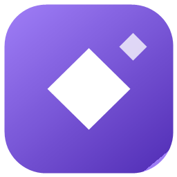

<p align="center"></p>

<h1 align="center">Alicecode</h1>

<p align="center">Настольный помощник по коду на базе Yandex AI Studio для Windows.</p>

<p align="center">
  <a href="https://github.com/Nyan4eg/Alicecode/releases/latest">Скачать для Windows</a> ·
  <a href="#быстрый-старт">Быстрый старт</a> ·
  <a href="LICENSE">MIT</a>
</p>


## Быстрый старт

1. Скачайте `Alicecode-Setup-*-x64.exe` из [последнего выпуска](https://github.com/Nyan4eg/Alicecode/releases/latest) и запустите его. Ярлык **Alicecode** появится на рабочем столе и в меню «Пуск».
2. Для работы агента установите [Grok Build](https://docs.x.ai/build/overview) и [Git для Windows](https://git-scm.com/install/windows), если их ещё нет. Языковой рантайм нужен для команд самого проекта. Например, для `node --test` нужен Node.js.
3. В **Настройках** выберите подключение к Yandex. Для AI Studio укажите [API-ключ и ID каталога](https://aistudio.yandex.ru/ru/docs/ai-studio/api-ref/authentication). Для подписки используйте [каталог Yandex Cloud и пользовательский IAM-токен](https://aistudio.yandex.ru/ru/docs/ai-studio/manage/concepts/subscription-usage), введённый вручную или получаемый через профиль `yc`. Ключ, сохранённый в прототипе Alicecode под той же учётной записью Windows, подхватывается автоматически.
4. Создайте проект или откройте существующую папку. Попросите Алису разобраться с кодом, внести правку или запустить тесты. Запрошенные агентом разрешения видны в чате.

Установщик x64 рассчитан на Windows 10 и 11. Исполняемый файл пока без подписи Authenticode, поэтому Windows может показать предупреждение о неизвестном издателе. Выпуск содержит контрольную сумму SHA-256.

## Проекты и история

- У каждого проекта свои чаты. После закрытия Alicecode можно открыть предыдущий чат и продолжить ту же сессию.
- Черновик сообщения, выбранные фрагменты и копии внешних вложений сохраняются после перезапуска. Открытые вкладки редактора, несохранённый код, курсор, выбранная панель и позиция в чате также восстанавливаются. Несохранённый код хранится в профиле и не записывается в проект до нажатия **Сохранить**. Если файл на диске изменился, при сохранении появится сравнение.
- Проекты и чаты можно переименовывать. `Ctrl+K` открывает поиск по названиям и сообщениям всех проектов, `Ctrl+N` создаёт чат, `F2` переименовывает чат, а `Shift+F2` — проект. `Ctrl+Shift+E` показывает или скрывает панель файлов.
- Перетащите разделитель панели или измените ширину стрелками, когда он в фокусе. Выбранная ширина сохраняется после перезапуска.
- Сводка в чате показывает изменённые файлы и результаты тестов. Вывод команд доступен в журнале действий.
- Ответы поддерживают Markdown: заголовки, списки, таблицы, цитаты и блоки кода с подсветкой и копированием. HTML из ответов отображается как текст; внешние картинки не загружаются. Вывод инструментов свёрнут в журнале, а ошибки отмечены отдельно.
- Файлы и diff открываются рядом с чатом. При запросе разрешения Alicecode показывает команду и папку либо предлагаемый фрагмент правки.
- История, ссылки на проекты и зашифрованный ключ хранятся в `%APPDATA%\Alicecode`. Установка и обновления используют этот же профиль Windows. Файлы проектов остаются в выбранных папках.
- Приложение обращается к Yandex AI Studio за ответами модели. Запрос может содержать контекст чата и фрагменты файлов или вывода команд, с которыми работает агент.
- Установленная версия автоматически проверяет GitHub Releases и загружает обновление. Установить его можно через **Настройки → Перезапустить и обновить**. Текущую версию и состояние загрузки видно там же.


## Работа с существующим кодом

- Откройте дерево папок или нажмите `Ctrl+P` для поиска по имени и пути. Добавьте `:номер_строки`, чтобы сразу перейти к нужной строке. Поиск в Git-проектах учитывает правила исключения Git.
- `Ctrl+Shift+F` открывает поиск по содержимому. Результат показывает путь, строку и фрагмент кода: откройте его в редакторе или нажмите **@ В чат**. Поиск буквальный, без учёта регистра; пропускает двоичные и слишком большие файлы, соблюдает исключения Git и показывает достижение лимита.
- Введите `@` в черновике или нажмите **Контекст**. Выберите файл, при необходимости укажите строки и просмотрите фрагмент перед прикреплением. Если фрагмент изменится на диске, Alicecode попросит проверить его заново.
- Кнопки **Файлы** и **Папка** добавляют текстовые вложения с диска. Файлы также можно перетащить в чат. Для папки отметьте нужные файлы в дереве. Alicecode сохраняет локальную копию выбранного текста. Небольшие файлы включаются в запрос, большие Алиса читает через файловый инструмент. Вложения доступны этому инструменту только для чтения.
- **Изменения за запуск** в ответе показывают сохранённый diff между началом и концом задачи. Он отражает и внешние изменения за это время. Во вкладке **Изменения** отдельно видны индекс Git, рабочая папка и новые файлы. Для больших сравнений приложение показывает, если часть файлов пропущена.
- Стрелки над diff переходят между изменёнными фрагментами и файлами. **К строке в редакторе** открывает текущий участок. Повтор тестов доступен прямо в сводке ответа; откат остаётся рядом с результатом задачи.
- Откройте команду в **Журнале действий** и нажмите **Повторить**. Alicecode покажет команду и рабочую папку, затем запустит её локально после подтверждения. Повтор доступен для распознанных тестовых команд с сохранённой папкой, например `npm test` и `node --test`. Составные команды и записи без рабочей папки можно запустить через новый запрос в чате.

## Редактирование, откат и коммиты

Над полем сообщения выберите **Обсудить** или **Изменить код**. В обсуждении модель получает только инструменты чтения файлов, просмотра папок и поиска по содержимому; инструментов записи и запуска процессов нет. Режим изменения использует Grok Build и существующие разрешения. Режим хранится в чате; предыдущий ответ обсуждения и пути справочных вложений передаются при переходе к изменениям. Ручное редактирование и явно запущенные пользователем действия интерфейса остаются доступны в обоих режимах.

- Нажмите **Редактировать** в просмотре файла. Редактор открывает вкладки, подсвечивает код, поддерживает поиск и переход к строке. Сохраняйте через `Ctrl+S`. При внешнем изменении файла Alicecode показывает сравнение с черновиком перед сохранением.
- Кнопка **Откатить правки…** появляется у ответов с записанными через Alicecode правками существующих текстовых файлов. Выберите файл и просмотрите обратное изменение. Правки пользователя в других строках сохраняются. При конфликте Alicecode показывает версии фрагмента. Правки через команды попадают в общее сравнение за запуск.
- Во вкладке **Изменения** добавляйте в индекс файлы или отдельные текстовые фрагменты. Действие **Коммит…** показывает ветку и полный staged diff репозитория. Коммит создаётся по подтверждённому индексу Git.
- В меню **⋯** чата доступны переименование, архив и удаление. Архив ищется через **Включить архив**. Удаление убирает историю и локальную сессию выбранного чата.

## Модели

Модель выбирается в заголовке чата. Новые чаты открываются с Qwen3.6 35B. Ручной выбор хранится в чате. На калькуляторе с падающим тестом каждая из шести исходных моделей справилась в трёх из трёх прогонов.

Доступные модели зависят от способа подключения. Режим API-ключа использует каталог AI Studio и тарификацию по потреблению. Режим подписки использует отдельный адрес API и список моделей из документации Яндекса. Если подписочный лимит исчерпан, выбрать оплату через ключ можно вручную в настройках. [Каталог Yandex AI Studio](https://aistudio.yandex.ru/ru/docs/ai-studio/operations/models/get) · [Модели подписки](https://aistudio.yandex.ru/ru/docs/ai-studio/manage/concepts/subscription)

## Сборка из исходников

Нужен Node.js 24. В корне репозитория выполните:

```powershell
npm ci
npm test
npm start
npm run dist:win
```

Установщик, `latest.yml` и файл блоков создаются в `dist/`. GitHub Actions собирает и публикует комплект при отправке тега `vX.Y.Z`, совпадающего с версией в `package.json`.

Electron отвечает за окно и локальное хранение. Grok Build подключается по ACP и запускает инструменты проекта. Локальный адаптер отправляет запросы выбранной модели через API Яндекса.
