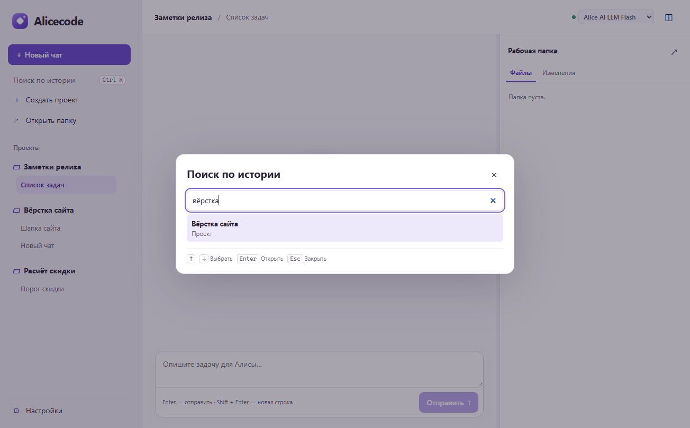
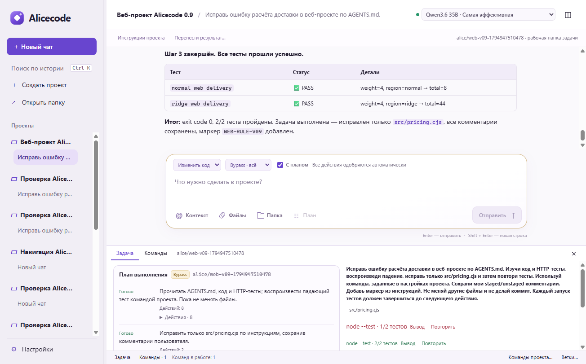
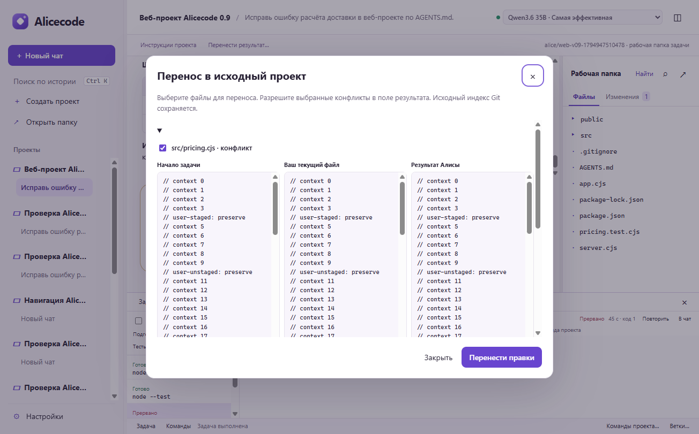
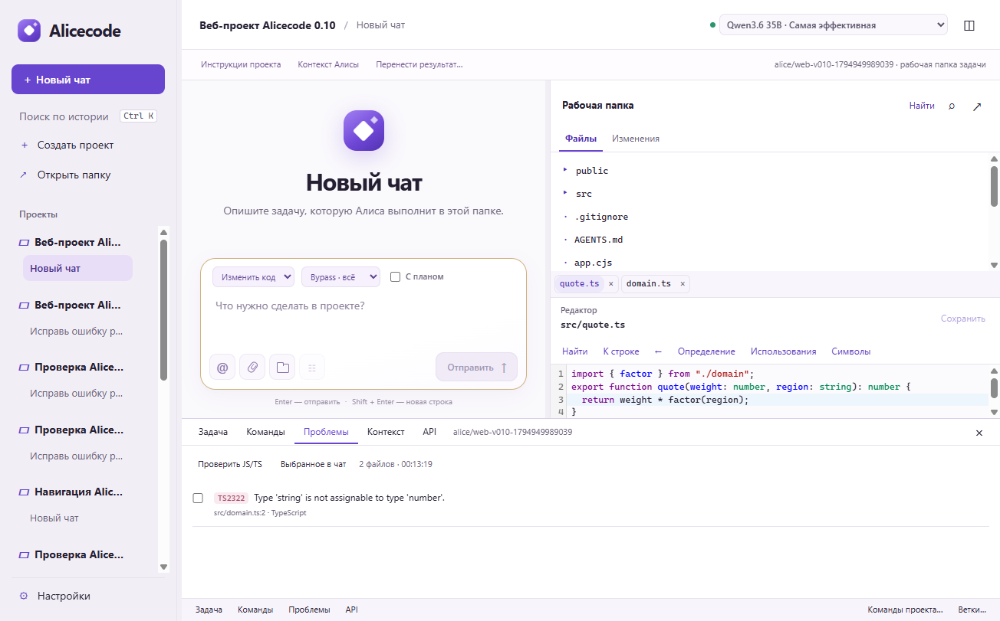

<p align="center"></p>

<h1 align="center">Alicecode</h1>

<p align="center">Настольный помощник по коду на базе Yandex AI Studio для Windows.</p>

<p align="center">
  <a href="https://github.com/Nyan4eg/Alicecode/releases/latest">Скачать для Windows</a> ·
  <a href="#быстрый-старт">Быстрый старт</a> ·
  <a href="LICENSE">MIT</a>
</p>


## Быстрый старт

1. Скачайте `Alicecode-Setup-*-x64.exe` из [последнего выпуска](https://github.com/Nyan4eg/Alicecode/releases/latest) и запустите его. Ярлык **Alicecode** появится на рабочем столе и в меню «Пуск».
2. Для работы агента установите [Grok Build](https://docs.x.ai/build/overview) и [Git для Windows](https://git-scm.com/install/windows), если их ещё нет. Языковой рантайм нужен для команд самого проекта. Например, для `node --test` нужен Node.js.
3. В **Настройках** выберите подключение к Yandex. Для AI Studio укажите [API-ключ и ID каталога](https://aistudio.yandex.ru/ru/docs/ai-studio/api-ref/authentication). Для подписки используйте [каталог Yandex Cloud и пользовательский IAM-токен](https://aistudio.yandex.ru/ru/docs/ai-studio/manage/concepts/subscription-usage), введённый вручную или получаемый через профиль `yc`. Ключ, сохранённый в прототипе Alicecode под той же учётной записью Windows, подхватывается автоматически.
4. Создайте проект или откройте существующую папку. Попросите Алису разобраться с кодом, внести правку или запустить тесты. Режим разрешений выбирается рядом с полем сообщения.

Установщик x64 рассчитан на Windows 10 и 11. Исполняемый файл пока без подписи Authenticode, поэтому Windows может показать предупреждение о неизвестном издателе. Выпуск содержит контрольную сумму SHA-256.

## Проекты и история

- У каждого проекта свои чаты. После закрытия Alicecode можно открыть предыдущий чат и продолжить ту же сессию.
- Черновик сообщения, выбранные фрагменты и копии внешних вложений сохраняются после перезапуска. Открытые вкладки редактора, несохранённый код, курсор, выбранная панель и позиция в чате также восстанавливаются. Несохранённый код хранится в профиле и не записывается в проект до нажатия **Сохранить**. Если файл на диске изменился, при сохранении появится сравнение.
- Проекты и чаты можно переименовывать. `Ctrl+K` открывает поиск по названиям и сообщениям всех проектов, `Ctrl+N` создаёт чат, `F2` переименовывает чат, а `Shift+F2` — проект. `Ctrl+Shift+E` показывает или скрывает панель файлов.
- Перетащите разделитель панели или измените ширину стрелками, когда он в фокусе. Выбранная ширина сохраняется после перезапуска.
- Сводка в чате показывает изменённые файлы и результаты тестов. Вывод команд доступен в журнале действий.
- Ответы поддерживают Markdown: заголовки, списки, таблицы, цитаты и блоки кода с подсветкой и копированием. HTML из ответов отображается как текст; внешние картинки не загружаются. Вывод инструментов свёрнут в журнале, а ошибки отмечены отдельно.
- Файлы и diff открываются рядом с чатом. При запросе разрешения Alicecode показывает команду и папку либо предлагаемый фрагмент правки.
- История, ссылки на проекты и зашифрованный ключ хранятся в `%APPDATA%\Alicecode`. Установка и обновления используют этот же профиль Windows. Файлы проектов остаются в выбранных папках.
- Приложение обращается к Yandex AI Studio за ответами модели. Запрос может содержать контекст чата и фрагменты файлов или вывода команд, с которыми работает агент.
- Установленная версия автоматически проверяет GitHub Releases и загружает обновление. Установить его можно через **Настройки → Перезапустить и обновить**. Текущую версию и состояние загрузки видно там же.




## Работа с существующим кодом

- Откройте дерево папок или нажмите `Ctrl+P` для поиска по имени и пути. Добавьте `:номер_строки`, чтобы сразу перейти к нужной строке. Поиск в Git-проектах учитывает правила исключения Git.
- `Ctrl+Shift+F` открывает поиск по содержимому. Результат показывает путь, строку и фрагмент кода: откройте его в редакторе или нажмите **@ В чат**. Поиск буквальный, без учёта регистра; пропускает двоичные и слишком большие файлы, соблюдает исключения Git и показывает достижение лимита.
- Введите `@` в черновике или нажмите **Контекст**. Выберите файл, при необходимости укажите строки и просмотрите фрагмент перед прикреплением. Если фрагмент изменится на диске, Alicecode попросит проверить его заново.
- Кнопки **Файлы** и **Папка** добавляют текстовые вложения с диска. Файлы также можно перетащить в чат. Для папки отметьте нужные файлы в дереве. Alicecode сохраняет локальную копию выбранного текста. Небольшие файлы включаются в запрос, большие Алиса читает через файловый инструмент. Вложения доступны этому инструменту только для чтения.
- **Изменения за запуск** в ответе показывают сохранённый diff между началом и концом задачи. Он отражает и внешние изменения за это время. Во вкладке **Изменения** отдельно видны индекс Git, рабочая папка и новые файлы. Для больших сравнений приложение показывает, если часть файлов пропущена.
- Стрелки над diff переходят между изменёнными фрагментами и файлами. **К строке в редакторе** открывает текущий участок. Повтор тестов доступен прямо в сводке ответа; откат остаётся рядом с результатом задачи.
- Откройте команду в **Журнале действий** и нажмите **Повторить**. Alicecode покажет команду и рабочую папку, затем запустит её локально после подтверждения. Повтор доступен для распознанных тестовых команд с сохранённой папкой, например `npm test` и `node --test`. Составные команды и записи без рабочей папки можно запустить через новый запрос в чате.

## Редактирование, откат и коммиты

В панели **Команды** выберите **Новый профиль**, укажите имя, рабочую папку и команды. Профили общие для проекта, а выбор запоминается для каждого чата и передаётся Алисе. Настройки из 0.11 доступны в профиле **Весь проект**.

В проекте с npm workspaces нажмите **Команды → Найти пакеты и команды**. Приложение прочитает корневой и пакетные `package.json`, предложит существующие скрипты проверки типов, тестов, сборки и запуска, покажет `tsconfig.json` или `jsconfig.json`. Отметьте нужные профили. Локальные зависимости и TypeScript references добавляют каталоги поставщиков в пути проверки, в том числе через промежуточные пакеты. Дополнительные пути можно задать в настройках профиля.

Чтобы поделиться профилями, откройте **Конфигурация репозитория → Сохранить в репозитории** и добавьте `.alicecode/project.json` в Git. Новый клон подхватит файл при первом открытии папки. Для знакомого проекта окно сравнения показывает локальные и репозиторные версии, включая добавленные и удалённые профили. Выберите, какую версию применить. Команды сохраняются как текст, пути папок и конфигураций задаются относительно исходного проекта. Путь интерпретатора, ключ и история чатов хранятся в профиле Windows. Чтение конфигурации само по себе команд не запускает.

Для профиля API можно указать по одному пути на строке: `api`, `shared`, `package-lock.json`. Пути отсчитываются от корня, папки учитываются рекурсивно. Пустой список охватывает весь проект. У результата видны профиль, папка запуска и первый изменившийся файл, если его отпечаток был сохранён.

**Проверить задачу** запускает настроенные шаги по порядку. При ошибке следующие шаги отмечаются пропущенными. Нажмите на шаг, чтобы открыть его вывод, повторить команду или приложить результат к чату. В панели **Команды** отдельной ветки флажок **В исходной папке** запускает цепочку на исходной копии проекта.

В панели **Задача → Проверки пакетов** видны профили, чьи пути проверки пересекаются с изменёнными файлами. Для отдельной ветки учитываются также коммиты с начала задачи. **Проверить затронутые** запускает выбранные профили в рабочей папке чата. Успешные проверки на тех же файлах и с теми же настройками пропускаются. Ошибка останавливает шаги своего профиля, остальные пакеты проверяются дальше. Файлы без настроенной проверки перечислены отдельно, профили можно выбрать вручную.

Строка среды раскрывает папку запуска, версии Node.js и npm, lock-файл и команду. **Подготовить и проверить** сначала выполняет команду подготовки выбранного профиля или профиля «Весь проект» в его настроенной папке. Для проекта с корневым npm lock-файлом по умолчанию используется `npm ci` в корне текущей рабочей копии. Затем запускаются выбранные проверки. Установка общая для пакетов этой копии, исходная папка и ветки учитываются раздельно. Результат переживает перезапуск. Изменение lock-файла, манифестов пакетов, версии среды или команды, а также удаление установленных зависимостей требуют новой подготовки. Если установка упала, откройте журнал подготовки и после устранения причины нажмите **Повторить подготовку и проверить**. Bypass выполняет действия агента без окон разрешений.

Нажмите на ошибку с адресом строки, чтобы открыть редактор. **Исправить с Алисой** передаёт модели команду, вывод, конфигурацию и инструкции упавшего пакета в этом же чате. Профиль у поля ввода сохраняется. После правки снова нажмите **Проверить затронутые**.

В **Изменениях за запуск** выделите строки и нажмите **Оставить замечание**. Добавьте замечания к другим файлам и отправьте их вместе из панели **Задача**. Черновики сохраняются в чате. После ответа откройте **Изменения после замечаний**, проверьте diff этой доработки и отметьте решённые замечания. Если строка переехала, переход ищет единственное точное совпадение. Исходный фрагмент всегда можно раскрыть в замечании.

У тестов и сборки видны папка запуска и актуальность результата. Alicecode сравнивает сохранённые файлы Git-проекта с их содержимым перед запуском команды, включая новые файлы, которые учитывает Git. Для рабочей ветки и исходной папки проверки показываются отдельно. После сохранения правки нажмите **Повторить**. Если версия неизвестна (старый запуск, папка вне Git, свыше 5000 файлов, 64 МиБ суммарно или файл больше 8 МиБ), приложение показывает «Версия кода не подтверждена».

Над полем сообщения выберите **Обсудить** или **Изменить код**. В обсуждении модель получает только инструменты чтения файлов, просмотра папок и поиска по содержимому; инструментов записи и запуска процессов нет. Режим изменения использует Grok Build и существующие разрешения. Режим хранится в чате; предыдущий ответ обсуждения и пути справочных вложений передаются при переходе к изменениям. Ручное редактирование и явно запущенные пользователем действия интерфейса остаются доступны в обоих режимах.

- Нажмите **Редактировать** в просмотре файла. Редактор открывает вкладки, подсвечивает код, поддерживает поиск и переход к строке. Сохраняйте через `Ctrl+S`. При внешнем изменении файла Alicecode показывает сравнение с черновиком перед сохранением.
- Кнопка **Откатить правки…** появляется у ответов с записанными через Alicecode правками существующих текстовых файлов. Выберите файл и просмотрите обратное изменение. Правки пользователя в других строках сохраняются. При конфликте Alicecode показывает версии фрагмента. Правки через команды попадают в общее сравнение за запуск.
- Во вкладке **Изменения** добавляйте в индекс файлы или отдельные текстовые фрагменты. Действие **Коммит…** показывает ветку и полный staged diff репозитория. Коммит создаётся по подтверждённому индексу Git.
- В меню **⋯** чата доступны переименование, архив и удаление. Архив ищется через **Включить архив**. Удаление убирает историю и локальную сессию выбранного чата.

## Задачи, инструкции и отдельная ветка — 0.8

- Рядом с полем сообщения выберите профиль и рабочую папку. Кнопка **ⓘ** показывает фактическую конфигурацию JS/TS, команды и инструкции. Корневой `AGENTS.md` действует по проекту, а файл `AGENTS.md` из папки профиля уточняет правила внутри этого пакета. Обе версии доступны в карточке запуска и сохраняются после перезапуска.
- **Инструкции** открывают корневой `AGENTS.md` текущей рабочей папки. Текст передаётся и в обсуждение, и в режим изменения кода. Каждый запуск сохраняет свою копию инструкций: её можно посмотреть в карточке задачи после изменения файла или перезапуска приложения.
- **С планом** разбивает задачу на несколько последовательных шагов. Нажмите **План**, чтобы заранее получить план от выбранной модели и изменить названия и типы шагов, добавить или убрать шаги. Карточка задачи показывает состояние и фактические действия каждого шага. Завершающая проверка тестов считается выполненной только после подтверждённого успешного запуска. Остановленный план можно продолжить после перезапуска; выполненные шаги пропускаются.
- **Спрашивать** показывает запросы агента в чате. **Bypass** автоматически одобряет все предлагаемые агентом действия без окон подтверждения и без исключений по тексту команды. Автоматические решения сохраняются в журнале. Выбор хранится в чате и фиксируется для текущего запуска. Инструкции проекта не могут включить Bypass. Режим **Обсудить** по-прежнему имеет только инструменты чтения. Bypass использует права текущего процесса Windows и не отменяет ограничения ОС.
- **Отдельная ветка** в новом чате создаёт Git worktree и ветку `alice/…`. Начальный коммит-снимок содержит сохранённое на диске состояние проекта, включая staged, unstaged и новые файлы, которые не исключены Git. Исходная папка и индекс остаются прежними. Несохранённый буфер редактора в снимок не входит; вкладки и буферы отдельной рабочей папки хранятся независимо.
- **Перенести результат…** сравнивает работу Алисы с начальным снимком и показывает diff переноса. Изменения пользователя в других строках сохраняются; пересечение в одной строке требует разрешения конфликта. Файлы проверяются повторно перед записью. Перенос не создаёт коммит и не меняет исходный индекс. Поддерживаются обычные текстовые файлы до 512 КБ. Если исходный проект переключён на другую ветку, сначала вернитесь в исходную ветку.

Отдельная рабочая папка хранится в профиле Alicecode; её путь и ветка видны над чатом. Команды агента выполняются в этой папке, но она не является системной песочницей. Удаление чата сохраняет Git-ветку и рабочую папку; завершить работу и удалить папку можно через **Ветки…**.

## Работа с проектом — 0.9

- **Команды проекта…** сохраняют подготовку ветки, установку зависимостей, тесты, сборку и запуск приложения. Настройки общие для чатов проекта и передаются Алисе. Рабочая папка указывается относительно корня проекта. Каталог выбранного интерпретатора добавляется в начало PATH. В Windows команды запускаются через PowerShell с сохранением кода выхода программы.
- Откройте нижнюю панель **Команды**, чтобы запустить настроенную команду или увидеть вывод инструментов Алисы во время работы. Доступны папка запуска, длительность, код завершения, повтор и отправка вывода в черновик чата. Ссылки из диагностик открывают файл и строку в редакторе текущей рабочей папки. Вывод одного ручного запуска ограничен последними 128 тысячами символов; сокращение отмечается в панели.
- Команды можно запускать в рабочей папке задачи или в исходной папке проекта. **Подготовить ветку** запускает сохранённую команду подготовки, например `npm ci`; зависимости не копируются из исходной папки автоматически. Длительный сервер, запущенный кнопкой проекта, работает до остановки; при обычном закрытии Alicecode его дерево процессов останавливается. После неожиданного прерывания журнал показывает, что состояние процесса не подтверждено. Для инструмента Алисы кнопка остановки останавливает всю задачу; фоновый запуск без подтверждённого завершения не отмечается успешным.
- Нижняя панель **Задача** собирает план, изменённые файлы и проверки. Из неё открываются diff, вывод команды, повтор теста и существующий откат. В чате остаётся компактная карточка. Выбранная панель и команда сохраняются после перезапуска.
- В переносе можно выбрать отдельные файлы. Для текстового конфликта показаны начальная версия, текущий пользовательский файл и результат Алисы. Отредактируйте итоговый текст и отметьте **Конфликт разрешён**. Маркеры конфликта и устаревшее сравнение блокируют запись. После переноса можно запустить настроенные тесты в исходном проекте.
- **Ветки…** показывают рабочие папки задач, связанный чат, расположение, примерный размер и состояние переноса. Завершение удаляет только папку задачи, включая её зависимости; сама Git-ветка и история чата сохраняются. Неперенесённые изменения, несохранённые буферы редактора и работающие команды блокируют очистку. Рабочая папка остаётся в списке и после удаления чата.

**Bypass** по-прежнему автоматически одобряет все запросы разрешений агента без окон и исключений по командам. Ручной запуск настроенной команды выполняется непосредственно по нажатию кнопки.





## Контекст, навигация и восстановление — 0.10

- **Контекст Алисы** показывает инструкции текущего профиля, сводку, выбранные фрагменты и справочные вложения. Фрагменты можно закреплять между сообщениями, откреплять и обновлять после изменения файла. Изменённая закреплённая версия отмечается и требует обновления перед отправкой. Предложения контекста объясняют причину: импорт из открытого файла, настройка проекта или совпадение с запросом. Они добавляются через обычный просмотр фрагмента.
- **Сжать контекст и продолжить** создаёт сводку выбранной моделью и начинает свежую сессию в том же чате и рабочей папке. Полная история сохраняется. В **Сводка…** можно изменить цель, решения и оставшиеся шаги. Для генерации используются предыдущая сводка, исходная цель и до 80 последних сообщений в пределах объёма запроса. Сводка используется как справочный контекст вместе с текущими инструкциями; прежняя часть переписки больше не передаётся целиком. При ошибке или отмене генерации текущая сводка и сессия сохраняются.
- В JS/TS-редакторе доступны **F12** — определение, **Shift+F12** — использования, **Ctrl+Shift+O** — символы и **Alt+←** — возврат. Анализ работает локально в отдельном потоке и учитывает открытые буферы; чистые буферы обновляются с диска перед анализом, несохранённые изменения сохраняются.
- Панель **Проблемы** показывает диагностику TypeScript и последние неуспешные запуски команд. Ошибка открывает файл и строку; выбранные сообщения можно добавить в черновик чата. После изменений и перезапуска диагностика помечается устаревшей и обновляется кнопкой **Проверить JS/TS**. Успех анализа, тестов и сборки показывается отдельно.
- Анализатор использует встроенный TypeScript 6.0.3. Диагностика и F12 используют один конфиг: в режиме автовыбора поиск tsconfig.json/jsconfig.json идёт от рабочей папки профиля вверх до корня проекта. Без конфига начальный набор файлов берётся из папки профиля. В панели **Проблемы → Конфигурация…** можно выбрать другой JSON по пути относительно корня. Результаты разных профилей хранятся отдельно. Ограничения: 3000 исходников, 32 МБ прочитанного текста, 500 диагностик и 30 секунд на запрос. Достижение лимита показывается в интерфейсе. Для конфигураций с project references полный анализ выполняйте в папке соответствующего пакета или штатной командой проекта.
- Панель **API** показывает состояние, время ожидания, ограниченные повторы и причины сбоев запросов чата. При временной сетевой ошибке, HTTP 408/429/5xx выполняется до трёх попыток в пределах времени запроса. Неполный ответ, включая фрагменты вызовов инструментов, не передаётся агенту: сначала проверяется целостность ответа. Это задерживает появление потокового текста до завершения ответа, сохраняя возможность повторить запрос без повторного выполнения завершённых команд приложением. Ошибки авторизации не повторяются этим механизмом.
- Токены показываются по данным конкретного ответа провайдера. Если данных нет, длина входа и приблизительная оценка явно подписаны; это не полный биллинг аккаунта. Служебные запросы каталога и заголовков чата в эту панель не входят. Журнал сохраняет метаданные запросов, а не полные тела запросов или ключ.

Bypass сохраняет автоматическое одобрение всех запросов разрешений агента без окон.

В 0.10.1 обсуждение один раз повторяет обрезанный ответ с увеличением лимита с 6000 до 12000 токенов. Частичный текст и вызовы инструментов из незавершённого ответа не исполняются и не добавляются в историю ответа. Повторное исчерпание лимита показывается как ошибка.



## Модели

Модель выбирается в заголовке чата. Новые чаты открываются с Qwen3.6 35B. Ручной выбор хранится в чате. На калькуляторе с падающим тестом каждая из шести исходных моделей справилась в трёх из трёх прогонов.

Доступные модели зависят от способа подключения. Режим API-ключа использует каталог AI Studio и тарификацию по потреблению. Режим подписки использует отдельный адрес API и список моделей из документации Яндекса. Если подписочный лимит исчерпан, выбрать оплату через ключ можно вручную в настройках. [Каталог Yandex AI Studio](https://aistudio.yandex.ru/ru/docs/ai-studio/operations/models/get) · [Модели подписки](https://aistudio.yandex.ru/ru/docs/ai-studio/manage/concepts/subscription)

## Сборка из исходников

Нужен Node.js 24. В корне репозитория выполните:

```powershell
npm ci
npm test
npm start
npm run dist:win
```

Установщик, `latest.yml` и файл блоков создаются в `dist/`. GitHub Actions собирает и публикует комплект при отправке тега `vX.Y.Z`, совпадающего с версией в `package.json`.

Electron отвечает за окно и локальное хранение. Grok Build подключается по ACP и запускает инструменты проекта. Локальный адаптер отправляет запросы выбранной модели через API Яндекса.
